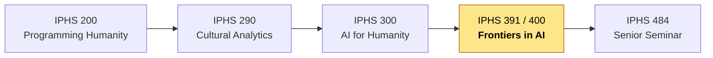
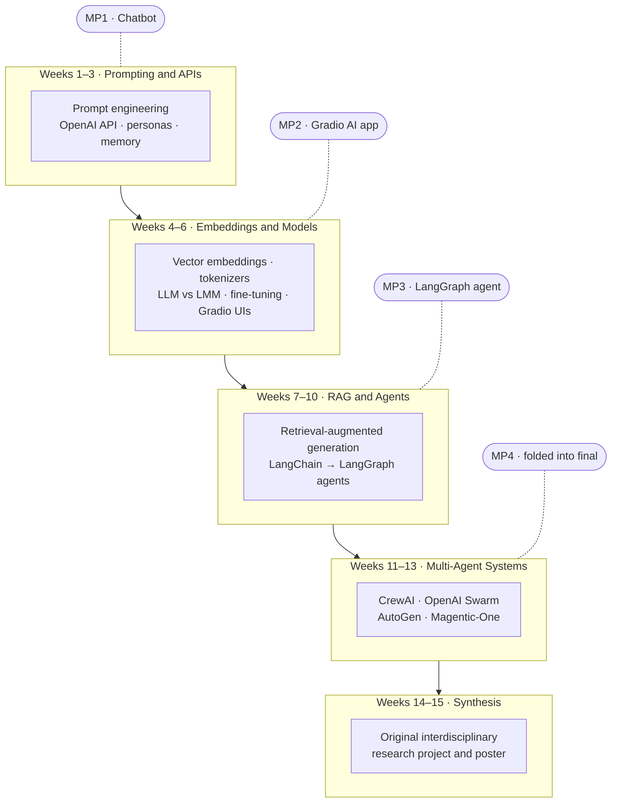
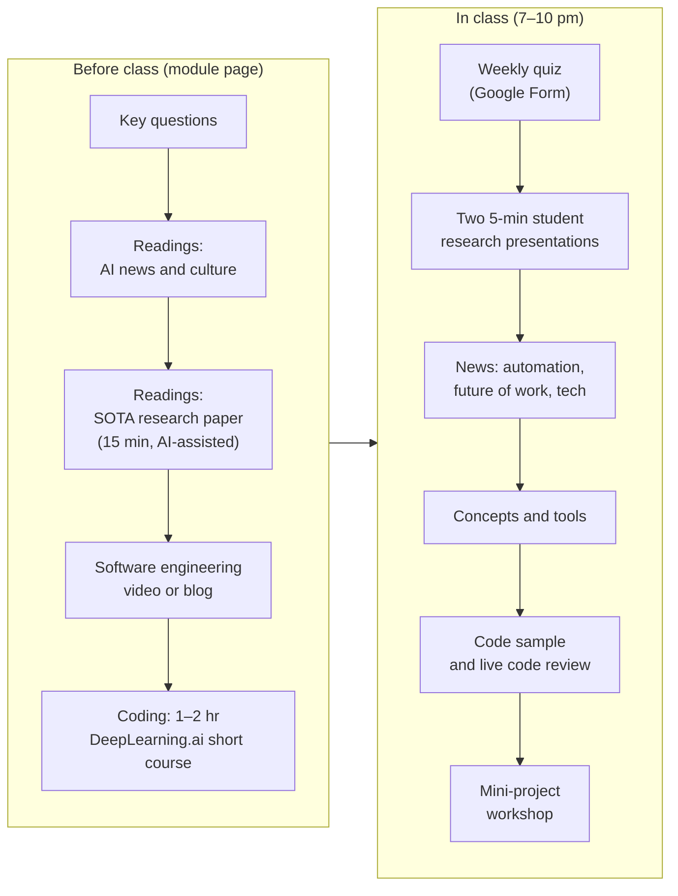
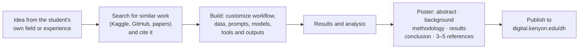
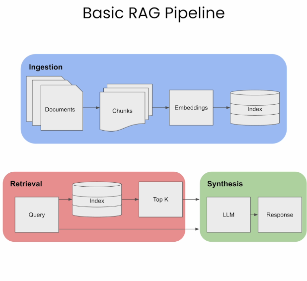
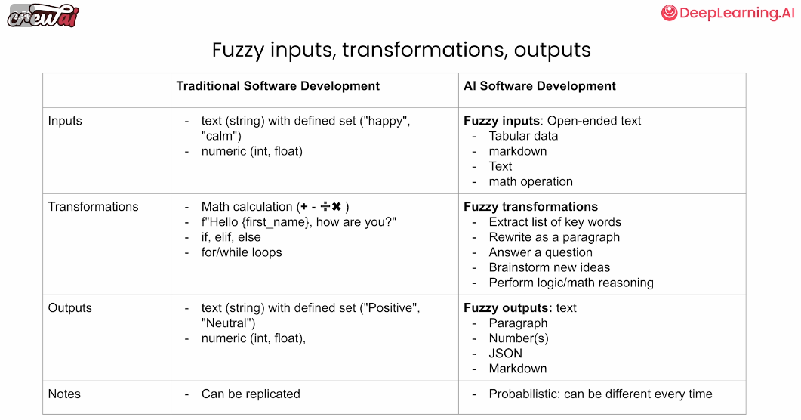
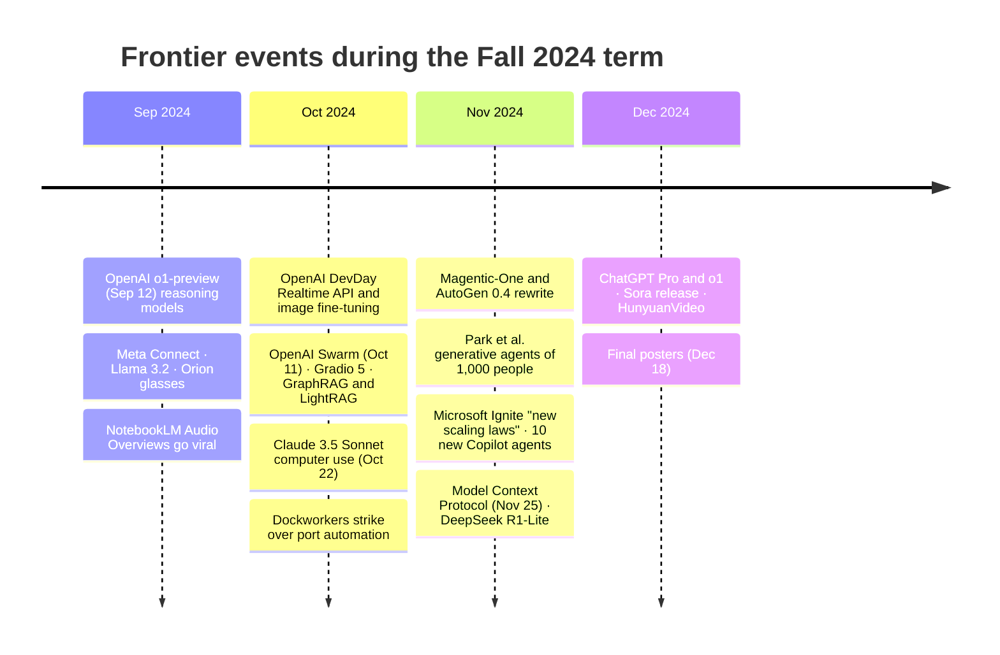
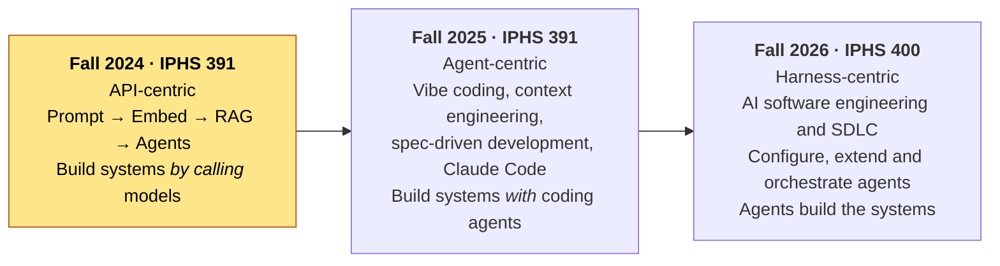

# Frontiers in AI

**Kenyon College · Integrated Program for Humane Studies (IPHS) · Fall 2024**
**IPHS 391 (Special Topics) · Instructor: Jon Chun**

This repository is the archived, final version of the first offering of *Frontiers in AI*, taught at Kenyon College in Fall 2024 under the special-topics number IPHS 391 ("Frontiers in Generative AI"). It is kept as a historical record of what the AI frontier looked like, and how it was taught, in the autumn of 2024: the semester that OpenAI's o1 reasoning models, Claude's computer use, and the Model Context Protocol all appeared mid-course.

The course was offered again in Fall 2025 and, after approval as a permanent course, became **IPHS 400: Frontiers in AI** from Fall 2026. All three are the same course under slightly different names and numbers; this README ends with a comparison across them.

| | |
|---|---|
| **Course** | IPHS 391: Frontiers in Generative AI (special topics; first offering) |
| **Term** | Fall 2024, Wednesdays 7:00–10:00 pm, Timberlake #5 (Evans Conference Room) |
| **Credit / CRN** | 0.5 unit (4 credit) · Section 00 · CRN 80044 |
| **Enrollment** | 15 students from all academic divisions |
| **Prerequisite** | Introductory Python |
| **Syllabus** | [syllabus.md](syllabus.md) · [PDF](syllabus_iphs391_frontiers_in_genai_2024fall_chunj.pdf) |
| **Student reviews** | [Anonymous end-of-term reviews (PDF)](docs/student_reviews_IPHS39SpecialTopicAIFrontiersLLMAutonomousWorkflows_fall2024_JonChun.pdf) |
| **Successor repos** | [Fall 2025 (IPHS 391)](https://github.com/jon-chun/iphs400-2025fall-frontiers-in-ai) · [Fall 2026 (IPHS 400)](https://github.com/jon-chun/theailab-net) |

> **Archive note.** This repository is a snapshot of the course as it stood in May 2025, after the term's final grades and a few months of reference-list updates. The original README it replaced is preserved verbatim at [docs/README_original_fall2024.md](docs/README_original_fall2024.md). The weekly module pages under [modules/](modules/) are unchanged and remain the primary record of each class.

---

## Contents

1. [Motivation and philosophy](#1-motivation-and-philosophy)
2. [Where the course sits in the IPHS curriculum](#2-where-the-course-sits-in-the-iphs-curriculum)
3. [Course design: a top-down abstraction ladder](#3-course-design-a-top-down-abstraction-ladder)
4. [Weekly schedule](#4-weekly-schedule)
5. [How a class week worked](#5-how-a-class-week-worked)
6. [Projects and grading](#6-projects-and-grading)
7. [The state of the art, Fall 2024](#7-the-state-of-the-art-fall-2024)
8. [What changed mid-semester](#8-what-changed-mid-semester)
9. [Outcomes and lessons from the first offering](#9-outcomes-and-lessons-from-the-first-offering)
10. [The course across three years: 2024 → 2025 → 2026](#10-the-course-across-three-years-2024--2025--2026)
11. [Repository guide](#11-repository-guide)
12. [IPHS 200 companion exercises](#12-iphs-200-companion-exercises)

---

## 1. Motivation and philosophy

How is AI changing humanity? The course set out from the realities of labor, knowledge work, and automation: can the current generation of rapidly improving autonomous AI agents collaboratively (or independently) craft novels, political campaigns, marketing strategies, financial analyst reports, software, music videos, or original scientific research papers? Students with basic Python and advanced curiosity got hands-on experience building their own agentic systems and a peek at the future of work.

Three design commitments shaped everything else:

- **Top-down, not bottom-up.** Unlike a traditional CS/AI course that builds from theory upward, the course started from real-world problems at a high level of abstraction and supplied an intellectual framework for each student to go as deep into the theory as their preparation and interests allowed. No mathematics beyond high school was assumed.
- **Human-centered and interdisciplinary.** IPHS students come from every academic division. Learning and projects were customized to each student's background, domain expertise, and interests, so that a classroom of philosophers, economists, biologists, and writers cross-pollinated ideas rather than competing on the same CS problem set.
- **Authentic, portfolio-building assessment.** By the end of the course every student was to have an online portfolio of industry-standard AI projects plus one original research project, suitable for graduate school or employment. Final projects were published as research posters to Kenyon's digital repository.

The paradox the course named on day one: rapid AI progress makes AI research simultaneously *more complex* (exponentially growing papers, deepening specialization) and *more accessible* (human-centered AI applications that are performant, easy to build, and reward domain expertise over specialized technical knowledge). The goal was to train emerging experts from all fields to think systematically, creatively, and iteratively in terms precise enough to turn ideas into well-designed, high-impact AI applications.

## 2. Where the course sits in the IPHS curriculum

IPHS developed what it believes to be the first human-centered AI curriculum centered on the big questions of humanistic inquiry (Chun & Elkins, [*The Crisis of Artificial Intelligence: A New Digital Humanities Curriculum for Human-Centred AI*](https://www.euppublishing.com/doi/full/10.3366/ijhac.2023.0310), IJHAC 2023). *Frontiers in AI* is the third course in that sequence.



Where IPHS 300 is a broad survey of AI for the humanities, *Frontiers* was deliberately narrow and deep: four leading-edge technologies that implement real-world research and industry solutions in fields like medicine, law, and public policy. A special-topics designation let Kenyon give students direct exposure to technologies that were "evolving too quickly to have been formalized into any fixed course or textbook," with the stated intent that the framework would eventually become a permanent course. It did, in 2026.

## 3. Course design: a top-down abstraction ladder

The semester climbed a ladder of abstraction, four technologies in four roughly three-week blocks, each ending in a mini-project. Every rung built on the one below: embeddings reappeared inside RAG, RAG became a tool inside an agent, and single agents became crews.



The instructor's framing was "from outside the black box inward": start with what a user sees (chat, prompts), then the API, then the representations (embeddings), then enough of the model internals to make sound engineering choices (tokenization, context windows, fine-tuning), and finally the software architectures that compose models into systems.

A parallel humanistic track ran through every week: readings and discussion on AI and the future of work, the economics of AI (Altman's *The Intelligence Age*, Amodei's *Machines of Loving Grace*, Khosla's *AI: Dystopia or Utopia?*, the Zitron critiques), AI safety and regulation (Anthropic's Responsible Scaling Policy, the Chun & Elkins ethics audit of LLM chatbots), and the effect of automation on labor (the Oct 2024 dockworkers' strike, the Columbo et al. "Terminator Economy" job-exposure study, the HBR gen-AI labor-market research).

## 4. Weekly schedule

Each row links to the module page that was the actual class handout. Dated items show the speed of the field: much of the material was published days before the class that used it.

| Wk | Date | Topic | Core technical content | Humanistic / news thread | Module |
|---:|---|---|---|---|---|
| 1 | Sep 4 | Introduction and AI overview | What is AI/AGI/ASI; LLM vs LMM; metrics and benchmarks; demo of SOTA apps (ChatGPT, Claude, Pi, Hume, Midjourney, Udio, ElevenLabs, Sora) | Jensen Huang on AI and education; the AI hype debate | [week1](modules/week1_ai_overview.md) |
| 2 | Sep 11 | Prompt engineering and the OpenAI API | REST APIs and auth; delimiters, structured output, JSON; LLM failure modes (hallucination, sycophancy) and mitigations; Reflection-70B controversy; the leaked Claude system prompt; laptop/Colab/Kaggle setup | Deloitte state of gen-AI in the enterprise; STORM and long-form AI writing | [week2](modules/week2_prompting.md) |
| 3 | Sep 18 | **Mini-Project 1: Chatbots** (Sep 18 session with Prof. Katherine Elkins) | Persona system prompts, conversation memory, n-shot in-context learning, chain of thought, Gradio; HELM and BIG-Bench Hard; LMSYS Arena; **o1 reasoning models (released Sep 12)** | Morris et al. *Levels of AGI*; Chun & Elkins ethics-based audit of LLM chatbots | [week3](modules/week3_miniproject1_chatbot.md) |
| 4 | Sep 25 | Embeddings | Semantic vector spaces; tokenization; similarity metrics; MTEB benchmark; Transformer Explainer; NotebookLM paper-to-podcast; v0 and Cursor | Deepfakes, IP and fair use; AI and worker power (Owen Davis) | [week4](modules/week4_embeddings.md) |
| 5 | Oct 2 | Models and fine-tuning | LLM life cycle; training datasets; BPE tokenizers; hyperparameters; GPU sizing; LoRA/Unsloth; multimodal benchmarks survey; OpenAI DevDay (Realtime API) and Meta Connect | Altman's *The Intelligence Age*; dockworkers' strike vs automation | [week5](modules/week5_models.md) |
| 6 | Oct 9 | **Mini-Project 2: Gradio AI app** | Gradio; Hugging Face Transformers pipelines; Whisper STT; vector databases (dense/sparse, HNSW, hybrid search); LLMs as "fuzzy databases"; fine-tuning vs pretraining | ARK on humanoid robotics; "OpenAI is a bad business"; ChatGPT Canvas | [week6](modules/week6_miniproject2_gradio_ai_app.md) |
| 7 | Oct 16 | Retrieval-augmented generation | RAG triad (query, context, response); sentence-window and auto-merging retrieval; query expansion; cross-encoder reranking; vector-DB bake-offs; RAGFlow, LightRAG, GraphRAG, LocalGPT-Vision; F5-TTS voice cloning | Hinton's Nobel and the Altman firing; LeCun on LLM limits; domain-specific industrial agents | [week7](modules/week7_rag.md) |
| 8 | Oct 23 | Agents: LangChain 1 | LangChain for LLM apps and chat-with-your-data; LangSmith, LangGraph, LangGraph Studio; multi-agent architectures; STOP self-improving code; **Claude 3.5 Sonnet computer use (Oct 22)**; OpenAI Moderation API | Andreessen's *Techno-Optimist Manifesto*; "Terminator Economy" job exposure; Anthropic RSP update | [week8](modules/week8_langchain1.md) |
| 9 | Oct 30 | Agents: LangChain 2 and LangGraph | Tools, state, pipelines and graphs; `@tool` decorators, Pydantic, async; OpenAI Swarm; Agent-S GUI agents; two-agent debate notebook | HeyGen avatars attending Zoom calls; NotebookLM, NotebookLlama, Claude Projects | [week9](modules/week9_langchain2.md) |
| 10 | Nov 6 | **Mini-Project 3: Agents** | Baseline LangGraph research agent (Pinecone + arXiv tools) and web-research agent; DocETL agentic document processing; LangGraph Academy; Berkeley tool-calling, MMMU and OSWorld benchmarks | Amodei's *Machines of Loving Grace*; Altman on startups and agents (20VC); Khosla's new economics | [week10](modules/week10_miniproject3_langchain.md) |
| 11 | Nov 13 | Multi-agents: CrewAI 1 | CrewAI (agents, tasks, crews, tools, memory); OpenAI Swarm routines and handoffs; 5 levels of AI agents; surveys of LLM-based MAS and agent architectures; Groq, Gemini and Grok free tiers | PwC AI job barometer; Magentic-One; test-time training on ARC | [week11](modules/week11_multiagents.md) |
| 12 | Nov 20 | Multi-agents: CrewAI 2 · MP4 | Custom crews; CrewAI + LangGraph; AutoGen Studio, AgentOps, LangSmith; Gemini search grounding; multimodal DocVQA (ColPali + Qwen2-VL) | Park et al. *Generative Agent Simulations of 1,000 People*; HBR on gen-AI and the labor market; ESM3 protein design | [week12](modules/week12_miniproject4_multiagents.md) |
| — | Nov 27 | Thanksgiving break | | | |
| 13 | Dec 4 | AI now: AutoGen and the agentic enterprise | AutoGen 0.2 vs 0.4 (actor model, event-driven core); Magentic-One; Copilot Studio and Microsoft's agent ecosystem; why developers abandon LangChain; LangChain *State of AI Agents* | Nadella's "new scaling laws" (Ignite 2024); IDC AI trends; LLMtheism and AI-generated religions | [week13](modules/week13_ai_now.md) |
| 14 | Dec 11 | AI and the future · poster draft | **Model Context Protocol (announced Nov 25)**; PydanticAI, Bee, n8n, Flowise; LLMs-as-judges survey; ChatGPT Pro and o1; HunyuanVideo; Bolt.diy | AI geopolitics (national-security memo, AI czar, US–China race); job displacement and the lump-of-labor fallacy | [week14](modules/week14_ai_future.md) |
| 15 | Dec 18 | Final project due (exam week) | Poster, code and data submitted | | |

Dates are the Wednesday class meetings reconstructed from the module pages and commit history; the module pages themselves are the authoritative record.

Reflection questions for each block, and the four-block syllabus structure, are in [syllabus.md](syllabus.md).

## 5. How a class week worked

Each three-hour Wednesday evening followed the same rhythm, and each module page was laid out in the same order so students always knew where to look.



Three habits were deliberate pedagogy rather than convenience:

- **Reading research with AI.** Students were told to spend only 15 minutes per paper, reading the abstract, introduction, figures and conclusion, and to use NotebookLM, ChatGPT or Claude to outline the rest. Learning to grok a paper quickly *with* AI was itself a course outcome.
- **DeepLearning.ai short courses as the coding spine.** Roughly one hour of guided notebooks per week (prompt engineering, embeddings, vector databases, Gradio, fine-tuning, advanced RAG, LangChain, LangGraph, CrewAI, AutoGen). The instructor rewrote several to run local models in Colab when the hosted endpoints broke, and those notebooks are in [code/deeplearningai/](code/deeplearningai/).
- **Sticker shock as a lesson.** API budgets were capped at $5–10 and keys were created together in class; cost, rate limits and error handling were treated as first-class engineering concerns, not afterthoughts.

## 6. Projects and grading

| Component | Weight |
|---|---:|
| Class participation (including a 5-minute research presentation) | 20% |
| Weekly quizzes | 30% |
| Four mini-projects | 30% |
| Final project (original interdisciplinary research, poster) | 20% |

### Mini-projects

| # | Project | Stack | What students built | Due |
|---|---|---|---|---|
| 1 | **Persona chatbot** | Python, OpenAI API, optional Gradio | A chatbot with a distinctive persona set by the system prompt, accumulated conversation history, n-shot in-context examples and at least one further prompting strategy (e.g. chain of thought); optional voice or image input. Submitted as a Colab or `.py` in the student's own GitHub repo. | Sep 22 |
| 2 | **Gradio AI app** | Gradio, Hugging Face Transformers, OpenAI API, Whisper, vector DBs | An original application combining two or more models or pipeline stages behind a Gradio UI, built around embeddings and similarity (search, recommendation, Q&A). The model example was an audio-lecture → transcript → summary → illustrated notes → spoken audio pipeline with human-in-the-loop image selection. | Oct 13 |
| 3 | **LangGraph agent** | LangChain, LangGraph, Pinecone, free-tier search/news APIs | Customize or extend one of two baselines (an arXiv research agent with RAG and a web-research agent) with the student's own data, prompts, tools and agents to automate a workflow they knew well: job search, chatbot simulation, research synthesis, report writing, dataset creation. | mid-Nov |
| 4 | **Multi-agent automated workflow** | CrewAI, OpenAI Swarm, AutoGen | A crew of role-playing agents automating a knowledge workflow. **By class vote this was folded into the final project**, raising the final to 30% of the grade. | — |

The syllabus had originally specified Hugging Face mechanistic interpretability for project 2 and AutoGen simulations for project 4. Both were replaced during the term as the field moved: Gradio-based multi-model apps proved a better vehicle for embeddings, and CrewAI and the newly released OpenAI Swarm had overtaken AutoGen 0.2 as the accessible multi-agent frameworks by November.

### Final project

An original interdisciplinary research project applying at least one of the four technologies, presented as a research poster in the IPHS poster template (PowerPoint, for publication to [digital.kenyon.edu/dh](https://digital.kenyon.edu/dh/)). A complete draft was due in early December, a week before the final, and the final poster, code and data on December 18 (the exam-week deadline, with no extensions possible under college rules).



Guidance that proved durable across later years: your contribution is the research question, the dataset, the prompts or the analysis, not the plumbing; cite any tutorial or demo you build on and explain what you changed; low-code tools (the then-new NotebookLM API) are fine if used creatively; disclose AI help on the poster and do not have AI write it.

Suggested starting points included cut-down versions of real products and startups (NotebookLM-style podcast generation, logo generation with Flux, competitive-analysis and fact-checking crews, customer-feedback analysis), plus the agentic tutorials collected in [week13](modules/week13_ai_now.md) and the open-ended pipeline sketch in [ai_final_project.md](modules/ai_final_project.md).

## 7. The state of the art, Fall 2024

A reference snapshot of what "frontier" meant during this course, drawn from what the modules actually assigned and demonstrated.

### Models

| Area | What students used or studied | Notes |
|---|---|---|
| Frontier chat LLMs | GPT-4o and GPT-4o mini; **o1-preview and o1-mini** (Sep 12); Claude 3.5 Sonnet (Jun, updated Oct 22) and 3.5 Haiku; Gemini 1.5 Pro/Flash | o1 introduced "reasoning models" and test-time compute mid-semester; prompting advice for o1 was added to week 4 the week it shipped |
| Open-weight LLMs | Llama 3.1 and 3.2 (via Ollama in Colab, Groq, Unsloth fine-tuning); Mistral/Pixtral Large; Qwen2-VL; OLMoE; the Reflection-70B episode | Open models were a free-tier fallback for API costs and the vehicle for fine-tuning exercises |
| Reasoning previews | DeepSeek R1-Lite preview (Nov 20); "test-time training" on ARC | Week 13 follow-ups; the full R1 release came after the term |
| Embeddings | OpenAI `text-embedding-3`; MTEB leaderboard; InstructOR; LLM2CLIP; ColPali | MTEB was the organizing benchmark for weeks 4–7 |
| Speech | Whisper (STT); OpenAI Realtime speech-to-speech API (DevDay, Oct 1); F5-TTS and Fish Speech voice cloning | Whisper + Gradio was the MP2 baseline |
| Image and video | DALL·E, Flux (with LoRA), Midjourney; Sora (preview only), Meta Movie Gen, Minimax/Hailuo, Runway, Tencent HunyuanVideo (Dec) | Shown in the weekly news segment; HunyuanVideo was the first strong open video model |
| Music and multimodal | Udio; Hume (affective); NotebookLM Audio Overviews (Sep) | NotebookLM's "paper to podcast" was a recurring in-class tool |

### Frameworks, tooling and protocols

| Layer | 2024 state |
|---|---|
| API conventions | OpenAI Chat Completions with function calling and JSON structured outputs; the Assistants API; the Moderation API. The course flagged the Chat→Completions endpoint churn in [openai_api_changes2024.md](modules/openai_api_changes2024.md) |
| RAG | LangChain and LlamaIndex pipelines over Chroma/Pinecone/FAISS; hybrid search and reranking; Microsoft GraphRAG and LightRAG (Oct) as graph-based alternatives; RAGFlow; MemoRAG |
| Agent frameworks | LangGraph (graph-based state machines) and LangGraph Studio (Aug); CrewAI; OpenAI Swarm (experimental, Oct 11); AutoGen 0.2 → 0.4 rewrite and Magentic-One (Nov); PydanticAI (Dec); Agent-S for GUI control |
| Agent protocols | **Model Context Protocol** announced Nov 25, covered in weeks 13–14 as "Anthropic's new agent protocol" |
| Computer use | Claude 3.5 Sonnet computer use beta (Oct 22); OSWorld benchmark |
| Observability | LangSmith; AgentOps; TruLens feedback functions (RAG triad) |
| AI-assisted coding | ChatGPT Canvas (Oct 3), Cursor, Bolt.new/oTToDev (Nov), v0, Replit agent; Claude Projects and Artifacts | Covered as news and demos, not yet as a course skill |
| Low/no-code automation | n8n, Flowise, ActivePieces, CrewAI Studio, AutoGen Studio, Copilot Studio |
| Benchmarks | HELM, BIG-Bench Hard, MTEB, LMSYS Chatbot Arena, Open LLM Leaderboard, Berkeley Function Calling Leaderboard, MMMU, OSWorld, AgentBoard, ARC Prize 2024 |
| Compute | Google Colab (paid tier), Kaggle, Ollama locally; Groq and Gemini free tiers; Unsloth for QLoRA fine-tuning |

### Discourse

The non-technical readings capture the moment: scaling-law optimism (*The Intelligence Age*, *Machines of Loving Grace*, Nadella's "new scaling laws" of inference-time compute), the first serious bear cases (Zitron's "OpenAI is a bad business"), labor anxiety made concrete by a port strike over automation, the first large-scale generative-agent social simulations (Park et al., 1,000 people), and Microsoft's rapid consolidation of an agent ecosystem across Windows, Office, GitHub and Azure.



*Figure: the basic RAG pipeline as taught in week 7, from the DeepLearning.ai "Building and Evaluating Advanced RAG" course.*



*Figure: traditional vs AI software engineering, from the CrewAI multi-agent course used in week 11. In 2024 this contrast was a framing device; by 2026 it had become the whole course.*

## 8. What changed mid-semester

The syllabus warned that the course would begin nine months after it was written and that its four "frontiers" would be updated to reflect research, tooling and industry practice as of August 2024. The record shows how much moved in fifteen weeks:



Concrete course changes that followed: o1 prompting guidance added to week 4; computer use added to week 8; OpenAI Swarm added alongside CrewAI in week 11; AutoGen reframed in week 13 around the 0.4 actor-model rewrite rather than the 0.2 notebooks; MCP added to week 14 reading; and the mini-project 4 vote.

## 9. Outcomes and lessons from the first offering

- **Students from every division finished the ladder.** The anonymous end-of-term reviews ([PDF](docs/student_reviews_IPHS39SpecialTopicAIFrontiersLLMAutonomousWorkflows_fall2024_JonChun.pdf)) were strongly positive; the instructor's summary in the 2025 README: IPHS students "each mastered in their own fashion topics as complex and fast moving as AI, multi-agent frameworks, and automated agentic workflows."
- **Four projects in fifteen weeks was one too many.** The class vote to merge MP4 into the final project was repeated in 2025 and, in 2026, the fourth project became a lighter, later component.
- **Week 6 was the programming peak.** Three hours of coding plus an optional Chroma unit was acknowledged on the module page as "an unusually large amount of new concepts and code," because embeddings, vector databases and Gradio were new to most students while later weeks reused them.
- **Framework churn is a teaching problem.** LangChain's API changes, the Chat→Completions endpoint change, and AutoGen's rewrite all broke tutorials within the term. The "why we no longer use LangChain" discussion in week 13 was assigned deliberately so students would learn to evaluate frameworks, not just use them.
- **AI-assisted reading worked.** Fifteen-minute, AI-assisted paper reading let a non-CS class engage with *Levels of AGI*, MTEB, DocETL, the MAS surveys and the generative-agents paper at a level that supported discussion and quizzes.
- **The special-topics framing was vindicated.** The field's pace within one term was the argument for a permanent course that is rebuilt every year; the RAS committee approved it as IPHS 400 for Fall 2026.

## 10. The course across three years: 2024 → 2025 → 2026

The same course, rebuilt each year around whatever the frontier had become. The three offerings read as a record of how "building with AI" changed from calling an API, to steering an agent, to engineering the harness around fleets of agents.



| Dimension | Fall 2024 (this repo) | Fall 2025 | Fall 2026 |
|---|---|---|---|
| Number and status | IPHS 391, special topics, first offering | IPHS 391, special topics, second offering | **IPHS 400, permanent course** (RAS-approved) |
| Format | Wed 7–10 pm, 0.5 unit, 15 students | Wed 7–10 pm, 0.5 unit, 10 students | Tu/Th 2:40–4:00, 4 credits; prereq IPHS 200 or COMP 118 |
| Course site | GitHub README + module pages | GitHub README + module pages | [theailab.net](https://theailab.net), a login-gated site built with the course's own AI-SWE workflow |
| Organizing idea | Four technologies on an abstraction ladder | Same ladder, with AI coding agents and spec-driven development woven through | AI software engineering: harness engineering across a professional SDLC |
| Primary tool | OpenAI API in Colab/Jupyter | OpenAI/Gemini/Anthropic APIs plus Claude Code, Gemini CLI, OpenCode, VS Code | Claude Code CLI (primary agent), VS Code, GitHub, OpenRouter |
| Dev environment | Colab, Kaggle; local optional | Local laptop setup week 2 (brew/WSL2, uv, git, CLI IDEs) | MP1 *is* the environment: dotfiles, zsh, XDG, secrets hygiene |
| MP1 | Persona chatbot | Persona chatbot **plus an AI-built scoring rubric and report** | Dev-environment configuration and a website redesign (pass/no-pass) |
| MP2 | Gradio multi-model app on embeddings | **Collective research**: a class-built embedding benchmark of expert-labeled hard sentence pairs, aimed at publication | Web CMS built spec-first with tickets, tests, reviews, handoffs and a token ledger |
| MP3 | LangGraph agent customized to a workflow | Real-world RAG/GraphRAG design: group task reports plus an individual CAPB tech report | **AI Research Factory**: an agent pipeline that reads an arXiv methods paper, finds a gap, runs an experiment and drafts a paper the student audits |
| MP4 | CrewAI workflow, folded into final | Folded into final | TBA, 10% |
| Final | Research poster to digital.kenyon.edu/dh | Same, with declaration of AI use and ACM references | Same, with a proposal gate, a release form, and a written-exam alternative |
| Reading method | 15-min AI-assisted paper reading | Lightning arXiv presentations every week | Lightning presentations; skim-and-query with AI explicitly examined |
| Agent frameworks taught | LangChain, LangGraph, CrewAI, Swarm, AutoGen | LangChain/LangGraph 1.0, LangSmith, DeepAgents, OpenAI AgentKit, Claude Code subagents and skills | Claude Code skills, hooks, plugins, subagents, MCP; ARIS; Pocock/Pstack skill packs; DeepSeek and Google harnesses |
| Frontier models at the time | GPT-4o, o1-preview, Claude 3.5 Sonnet, Llama 3.1/3.2, Gemini 1.5 | GPT-5 and 5.1, Claude Sonnet 4.5 and Opus 4.5, Gemini 2.5 and 3, Qwen3, DeepSeek V3.2 | Claude Opus/Sonnet/Haiku 5.5, GPT-6, DeepSeek v4.1, open "RSI" coding models (Flint) |
| Defining mid-term event | o1 reasoning models; MCP announced | Agent Skills; AgentKit; LangChain 1.0; Gemini 3 and Antigravity | Harness engineering goes mainstream; "pace the frontier" debate |
| Secrets and safety | API budget caps | API budget caps; leaked-system-prompt analysis | Formal secrets-hygiene and least-privilege agent rules, graded |
| Cost to student | ~$100–150 (OpenAI, Colab) | ~$180 (OpenAI, Colab, Anthropic; free Gemini and Perplexity student tiers) | ~$150 (Claude subscription plus small API credit) |

Two through-lines never changed: the humanistic track on labor, ethics and what agentic systems do to knowledge work, and the final deliverable of an original, interdisciplinary, publicly published research project.

## 11. Repository guide

```
.
├── README.md                          # this file
├── syllabus.md                        # Fall 2024 syllabus (markdown)
├── syllabus_iphs391_…_2024fall_chunj.pdf
├── modules/                           # one page per week, plus ~100 topic reference pages
│   ├── week1_ai_overview.md … week14_ai_future.md
│   ├── *_notes.md                     # instructor working notes for several weeks
│   ├── ai_*.md                        # curated link collections (agents, rag, benchmarks, coding, …)
│   ├── signups_setups.md              # cloud sign-ups and laptop setup
│   ├── openai_api_changes2024.md      # the Chat → Completions API transition
│   └── ai_final_project.md            # open-ended final project pipeline sketch
├── code/
│   ├── notebooks/                     # course Colab notebooks (chatbots, Whisper, RAG, LangGraph,
│   │                                  #   debate agents, SentimentArcs, topic modeling, NotebookLM API)
│   ├── deeplearningai/                # DeepLearning.ai course notebooks, several rewritten for local models
│   └── acl2024/                       # EMNLP/CoNLL 2024 materials (instructor's AIStorySimilarity poster)
├── docs/                              # student reviews PDF, tool notes, this README's predecessor
├── exercises/                         # prompt-engineering exercises
├── images/                            # figures used in modules (RAG, CrewAI slides)
├── articles/, research/, reports/     # readings and reference PDFs
├── slides/                            # LangGraph Academy slides
└── paper_figures/, deepresearch/, demos/, data/
```

Secrets were scrubbed from this repository's history before publication; API keys in three saved notebooks were replaced with placeholders. Notebooks are otherwise byte-identical to the course versions.

## 12. IPHS 200 companion exercises

Two notebooks developed during this term were also used in IPHS 200 *Programming Humanity* and are kept here:

- **Diachronic sentiment analysis:** [SentimentArcs Simplified (10 Dec 2024)](code/notebooks/sentimentarcs_supersimplified_20241210%20%282%29.ipynb) (earlier dated versions are alongside it in [code/notebooks/](code/notebooks/))
- **Topic modeling:** [Topic Modeling in NLP with ABC News sample (Kaggle)](https://www.kaggle.com/code/asadozzaman/topic-modeling-in-nlp-with-abc-news-sample) · [Colab](code/notebooks/nlp_Topic_Modeling_in_NLP_with_ABC_news_sample_20241110.ipynb) · [Colab with button](code/notebooks/nlp_Topic_Modeling_in_NLP_with_ABC_news_sample_20241111.ipynb). Create a Kaggle account with a non-Kenyon Gmail and use *Copy and Edit* to make your own copy.

---

*Jon Chun · Kenyon College · [chunj@kenyon.edu](mailto:chunj@kenyon.edu) · [github.com/jon-chun](https://github.com/jon-chun) · More on the IPHS human-centered AI curriculum and mentored student research at [digital.kenyon.edu/dh](https://digital.kenyon.edu/dh/).*
